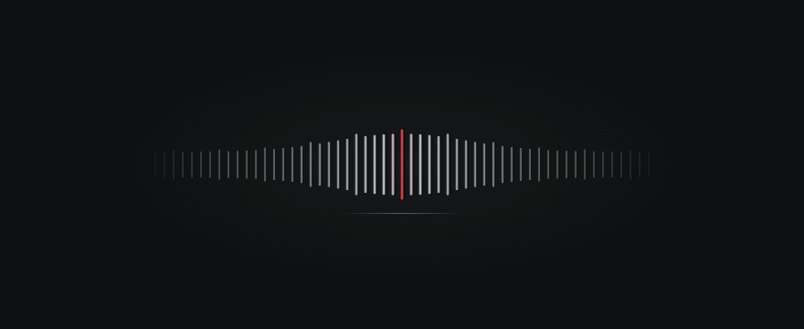

# Mechanical Bar

A minimal, tactile-feeling control for React: infinitely scrolling metal teeth, a fixed magnifying lens, and synthesized mechanical clicks.

Built with **React**, **TypeScript**, **Tailwind CSS**, and **shadcn/ui**. Silver, charcoal, and a restrained red accent give it a camera-inspired finish. The preview contains only the bar.

## Demo



Recorded from the running component. The loop demonstrates individual steps, sustained scrolling, direction changes, and settling into a detent. **GIFs are silent** — run the preview locally to hear the mechanical clicks.

## Features

- **Infinite travel:** scroll in either direction without endpoints or a growing DOM.
- **Fixed magnification:** nearby teeth smoothly grow taller, thicker, and brighter as they pass through the center.
- **Mechanical feedback:** a damped spring and one synthesized click per detent, without duplicate rebound clicks.
- **Keyboard and touch:** use the arrow keys, hold to repeat, or click/tap either half.
- **Accessible behavior:** real shadcn/ui buttons, focus feedback, reduced-motion support, and isolated keyboard handling.
- **Small implementation:** native animation frames and Web Audio; no animation library, remote fonts, or audio assets.

## Quick start

Requires Node.js 22.18+ or 24+, and npm.

```sh
npm ci
npm run dev
```

Open the printed local URL. Use **← / →**, hold a direction to repeat, or click/tap the corresponding half of the bar. The preview focuses the bar automatically. There is no passive autoplay or movement.

```sh
npm run build       # TypeScript check + production build in dist/
npm run lint
npm run test:unit   # spring, detents, reversal, and long-run rebasing
npm run test:e2e    # Playwright, using locally installed Google Chrome
```

For browser tests, install Google Chrome or change `channel: 'chrome'` in `playwright.config.ts` to your installed Playwright Chromium configuration. Tests start a local Vite server when needed. Screenshots are generated in `tests/artifacts/` (ignored by Git).

## Reuse

The public entry point is `src/components/mechanical-bar/index.ts`.

```tsx
import { MechanicalBar } from '@/components/mechanical-bar'

export function ExposureControl() {
  return (
    <MechanicalBar
      aria-label="Exposure adjustment"
      onStep={(direction) => console.log(direction)}
      sound
      volume={0.22}
    />
  )
}
```

Copy the `mechanical-bar` directory into another React/Tailwind/shadcn project, with its CSS. It imports `@/components/ui/button` and `@/lib/utils`; keep those aliases or adjust them. Add the official Button with `npx shadcn@latest add button` if it is missing. The component stylesheet is imported automatically. Tailwind supplies the Button classes and `sr-only` utility.

| Prop | Default | Meaning |
| --- | --- | --- |
| `onStep(delta)` | — | Actual tooth crossing: `-1` moves left, `1` moves right. Small rebound is filtered out. |
| `sound` | `true` | Enable or mute synthesized clicks. |
| `volume` | `0.22` | Master gain, clamped to `0–1`. |
| `disabled` | `false` | Disable both hit targets, stop held input, mute, and dim. |
| `className` | — | Additional classes; e.g. `max-w-[400px]`. |
| `style` | — | Inline styles and component CSS variables. |
| `aria-label` | Localized label | Name of the control; directional button names derive from it. The built-in label is Chinese; supply your application's label. |
| `autoFocus` | `false` | Focus the left hit target when mounted. Only the preview opts in. |

The component represents an endless relative control, not a bounded slider. Bind `onStep` to your own value or domain limits. It only handles arrows while one of its buttons is focused; multiple instances do not register competing global keyboard shortcuts. Tab switches targets, and Enter/Space activates a target.

## Appearance

```tsx
<MechanicalBar
  style={{
    '--bar-color': '#b9bfc4',
    '--bar-accent': '#e6333e',
    '--bar-spacing': 10,
    '--bar-magnification': 2.4,
  }}
/>
```

| CSS variable | Default | Meaning |
| --- | --- | --- |
| `--bar-color` | `#b9bfc4` | Silver metal base color. |
| `--bar-accent` | `#e6333e` | Color near the center. |
| `--bar-spacing` | `10` | Tooth pitch in pixels; unitless, clamped to 4–40. |
| `--bar-height` | `32` | Base tooth height in pixels; unitless. |
| `--bar-width` | `2` | Base tooth width in pixels; unitless. |
| `--bar-magnification` | `2.4` | Center height multiplier, clamped to 1–4. |
| `--bar-lens-radius` | `72` | Gaussian lens radius in pixels; unitless. |

Default dimensions are `width: 100%`, `max-width: 560px`, and `height: 128px`. If you substantially increase height or magnification, also increase container height using `style` or a Tailwind class. The component has a transparent background; the dark radial background belongs only to the preview.

## Behavior and lifecycle

- Movement and magnification share the same animated position. Only visible teeth plus a small buffer are rendered; position periodically rebases without changing the five-tooth rhythm.
- A tap advances one tooth. Holding waits 280 ms and then advances every 72 ms. Releasing a hold snaps to the nearest tooth. Changing focus, window blur, and a hidden document cancel held input.
- Each actual detent crossing calls `onStep` and plays one click. The spring uses hysteresis to avoid double callbacks and sounds during rebound.
- Audio is created/resumed only within a user gesture. If playback is unavailable or denied, motion and callbacks continue silently. `sound={false}` or `volume={0}` also works without initializing audio.
- Reduced motion removes travel and rebound while preserving the fixed lens profile. The bar keeps real buttons, accessible names, hidden instructions, and a subtle keyboard-focus underline.
- Unmounting cancels timers and animation frames, disconnects the resize observer, removes listeners, and closes the instance's audio context. React Strict Mode is supported.

The test-only harness under `tests/` is not included in the production build. Browser verification covers Chrome; Safari and Firefox have not been manually verified.

## Regenerate the GIF

The committed GIF is a capture of the actual component, not a separate animation mockup. With the development server running and Google Chrome installed:

```sh
node scripts/capture-demo.mjs
python3 -m pip install Pillow
python3 scripts/build-demo-gif.py
```

The capture uses deterministic browser time at 25 FPS. Raw frames stay in the ignored `tests/artifacts/gif-frames/` directory; the optimized loop is written to `docs/mechanical-bar-demo.gif`. Set `DEMO_URL` when the development server uses a different address.
