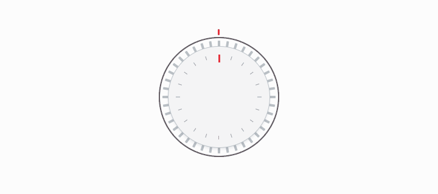
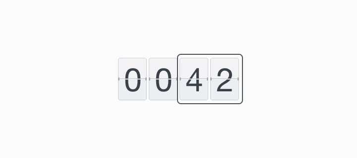
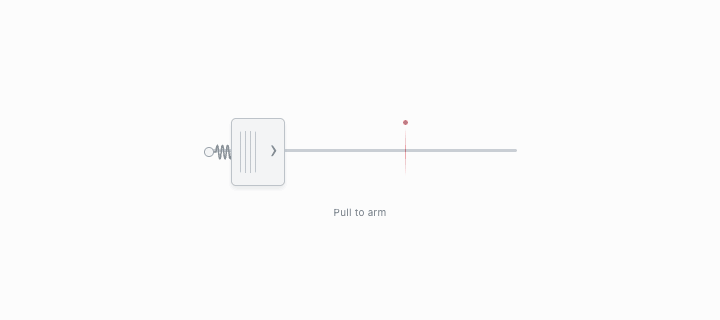

# Mechanical UI

Four independent React + TypeScript controls with simple mechanical forms, physical motion, and synthesized sound. The showcase uses a clean white panel, quiet gray surfaces, and small red accents.

Built with React 19 and shadcn/ui Button. The library ships scoped CSS; consuming applications do not need Tailwind. The local preview uses Vite and Tailwind CSS.

## Components

### Mechanical Bar

An infinite scale passing through a fixed magnifying lens. Click either half or focus the control and use **← / →**; hold to keep moving. Each actual detent crossing emits a step and a click, with rebound filtered out.


### Gear Wheel

A simple toothed dial. Drag vertically, scroll over it, or use the arrow keys. A quick drag coasts and settles into a detent; a click advances one tooth.



### Mechanical Flip

A controlled split-flap counter. Only changed digits flip. Rapid updates finish the current transition and converge to the latest value. Supply `onStep` to enable side clicks and arrow keys, or omit it for a display-only counter.



### Spring Pull

A spring-loaded handle with increasing resistance. Pull past the red marker and release to activate; shorter pulls return without activating. Hold **Space** to build tension, release to activate, or press **Enter** for direct keyboard activation. **Escape** cancels.



These GIFs are recordings of the running components at 25 FPS. **GIFs are silent**; run the preview to hear the detent, flap, and release sounds.

## Run locally

Requires Node.js 22.18+ or 24+, and npm.

```sh
git clone https://github.com/longjl1/online-knob.git
cd online-knob
npm ci
npm run dev
```

Open the local URL printed by Vite. The main page shows all four controls and a small sound toggle. Only focused controls handle keyboard input.

For an isolated preview, add `?demo=bar`, `?demo=gear`, `?demo=flip`, or `?demo=spring`. Only the isolated bar preview autofocuses; embedded components do not take focus automatically.

## Use the library

The package name is `@longjl1/mechanical-ui`. It is distributed through this GitHub repository, not published to the npm registry.

Build and pack locally:

```sh
npm run build:lib
npm pack
# In your React 19 application:
npm install /path/to/longjl1-mechanical-ui-0.1.0.tgz
```

Import the stylesheet once in your application entry point:

```tsx
import { useState } from 'react'
import {
  MechanicalBar,
  GearWheel,
  MechanicalFlip,
  SpringPull,
} from '@longjl1/mechanical-ui'
import '@longjl1/mechanical-ui/styles.css'

export function Controls() {
  const [value, setValue] = useState(42)
  const step = (delta: -1 | 1) => setValue(v => v + delta)

  return (
    <>
      <MechanicalBar aria-label="Fine adjustment" onStep={step} />
      <GearWheel aria-label="Coarse adjustment" onStep={step} />
      <MechanicalFlip value={value} digits={4} onStep={step} />
      <SpringPull onTrigger={() => setValue(0)} />
    </>
  )
}
```

Each component also has its own entry point:

```tsx
import { MechanicalBar } from '@longjl1/mechanical-ui/mechanical-bar'
import { GearWheel } from '@longjl1/mechanical-ui/gear-wheel'
import { MechanicalFlip } from '@longjl1/mechanical-ui/mechanical-flip'
import { SpringPull } from '@longjl1/mechanical-ui/spring-pull'
```

The components are independent: they do not need a provider, shared state, a global keyboard handler, or showcase styles. The stylesheet is scoped to the controls and does not reset the host page. All component prop types are exported.

## API

All four components accept:

| Prop | Default | Description |
| --- | --- | --- |
| `sound` | `true` | Enable synthesized mechanical feedback. |
| `volume` | See below | Gain, clamped to `0–1`; `0` is silent. |
| `disabled` | `false` | Disable input, cancel active interaction, mute, and dim. |
| `className` | — | Additional CSS classes. |
| `style` | — | Inline styles, including component CSS variables. |
| `aria-label` | Component name | Accessible control name; supply a localized label for your application. The bar retains its original Chinese default. |

Default volume: Bar `0.22`, Gear Wheel `0.18`, Mechanical Flip `0.16`, Spring Pull `0.22`.

| Component | Additional props | Behavior |
| --- | --- | --- |
| `MechanicalBar` | `onStep?: (delta: -1 \| 1) => void`, `autoFocus?: boolean` | `-1` moves left, `1` moves right. A callback fires per actual tooth crossed. Autofocus defaults to `false`. |
| `GearWheel` | `onStep?: (delta: -1 \| 1) => void` | `1` rotates clockwise, `-1` counterclockwise. Callbacks include inertia crossings. |
| `MechanicalFlip` | `value: number`, `digits?: number`, `onStep?: (delta: -1 \| 1) => void` | Controlled value; defaults to four digits, supports one to six. Truncates fractions and wraps modulo `10 ** digits`. Non-finite values display zero. |
| `SpringPull` | `onTrigger?: () => void`, `onPullChange?: (progress: number) => void`, `threshold?: number` | Threshold defaults to `0.72`, clamped to `0.25–0.95`. Triggers once on an armed release. Progress is `0–1` during input and returns to zero on release; it does not report the return animation. |

Bar and Gear Wheel are relative controls, so the application owns any value or limits. Mechanical Flip displays the supplied value and never mutates it internally.

## Appearance

Controls have transparent outer backgrounds and simple light gray surfaces. Customize them with CSS variables:

```tsx
<MechanicalBar
  style={{
    '--bar-color': '#737d86',
    '--bar-accent': '#e6333e',
    '--bar-spacing': 10,
    '--bar-magnification': 2.4,
  }}
/>
<GearWheel style={{ '--gear-accent': '#e6333e' }} />
<MechanicalFlip
  value={42}
  style={{ '--flip-digit-width': '56px', '--flip-digit-height': '84px' }}
/>
<SpringPull style={{ '--pull-accent': '#e6333e' }} />
```

The bar also exposes `--bar-height` (32), `--bar-width` (2), and `--bar-lens-radius` (72); these are unitless pixel values. Its default maximum width is 560px. Spacing is clamped to 4–40 and magnification to 1–4. If you increase the tooth height substantially, increase the component's container height too.

## Motion, audio, and accessibility

- Native animation frames drive detents, inertia, resistance, and spring return. The bar recycles visible teeth and rebases position; the wheel has a fixed set of teeth.
- Real shadcn/ui buttons provide names, focus, keyboard activation, and disabled behavior. Decorative artwork is hidden from assistive technology. The flip counter announces its complete value.
- `prefers-reduced-motion` removes bar travel, wheel coasting, flap rotation, and spring rebound. Static central magnification remains visible.
- Window blur and hidden tabs cancel active drags and held input. Cancelled or interrupted spring pulls never activate.
- Audio contexts are created or resumed after a user gesture. If audio is unavailable, controls continue silently. Display-only flip counters do not unlock audio on their own.
- Unmounting cancels animation frames and timers, removes listeners and resize observers, and closes per-instance audio contexts. React Strict Mode is supported.

## Development and verification

```sh
npm run typecheck
npm run lint
npm run build        # demo → dist/, library + declarations → dist-lib/
npm run test:unit    # detents, numerical rebasing, spring physics, digit formatting
npm run test:e2e     # browser behavior, touch, reduced motion, audio, cleanup
npm run test:package # packed consumer types, build, and browser rendering without Tailwind
```

Browser checks use locally installed Google Chrome via Playwright. Install Chrome or adjust `playwright.config.ts` and the capture/verification scripts for your installed browser. Firefox and Safari have not been verified.

The public source entry is `src/index.ts`. Individual implementations live in `src/components/{mechanical-bar,gear-wheel,mechanical-flip,spring-pull}`. Shared Web Audio and lifecycle hooks live in `src/lib`. Test harnesses, screenshots, and raw recording frames are excluded from production output.

## Regenerate demos

With the development server running and Chrome installed:

```sh
node scripts/capture-demo.mjs       # all four controls
python3 -m pip install Pillow
python3 scripts/build-demo-gif.py
```

Pass `bar`, `gear`, `flip`, or `spring` to both scripts to regenerate one demo. `DEMO_URL` overrides the server address. Capture advances browser motion and native flap animations together at 25 FPS. Raw frames remain under the ignored `tests/artifacts/gif-frames/` directory; encoded GIFs are written to `docs/`.

The restrained white presentation takes direction from [UI Components by Mik Skuza](https://dribbble.com/shots/25473428-UI-Components). All controls and demo assets in this repository are implemented and recorded locally.
